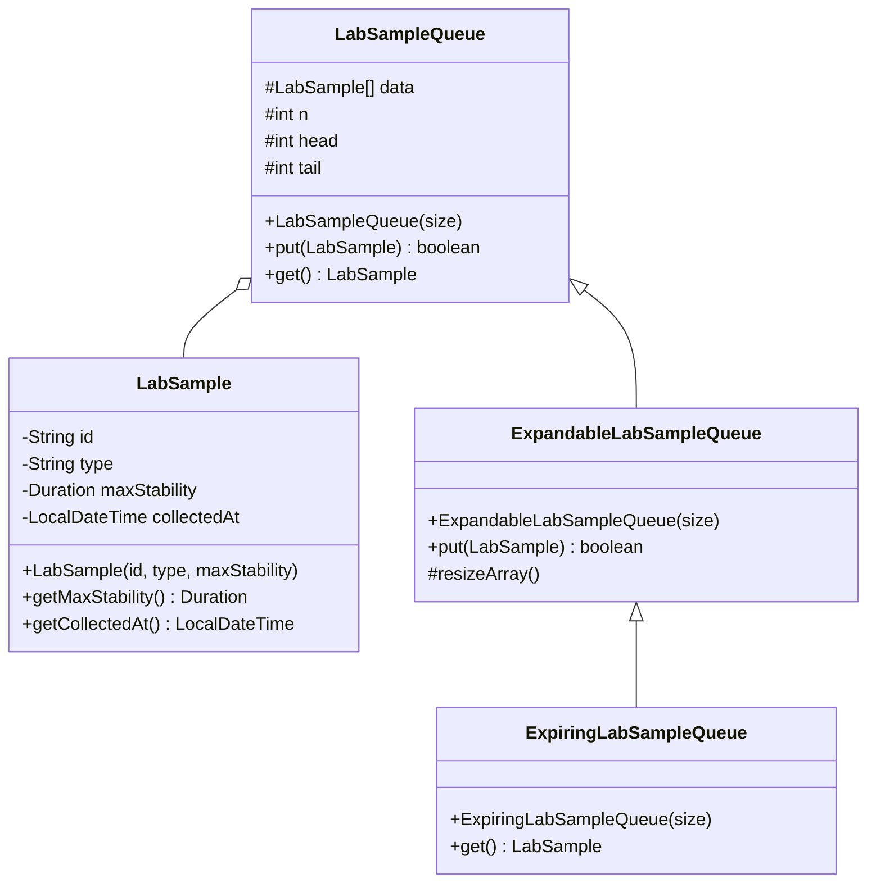

# Laborproben-Warteschlangen

Drei Warteschlangen (Queues) in Java, die Laborproben in der Reihenfolge ihres Eintreffens verwalten (FIFO). Jede baut auf der vorherigen auf: eine feste Queue, eine Queue, die automatisch wächst, und eine Queue, die abgelaufene Proben aussortiert.

Entstanden als **Übung 03** in der Lehrveranstaltung *Objektorientiertes Softwaredesign (OOS)* an der FH Hagenberg, WS 2026/27. Thema der Übung: **Vererbung**.

## Szenario

Ein Laborinformationssystem bekommt über den Tag verteilt Proben, z. B. Blut, Urin oder PCR-Abstriche. Sie müssen in der Reihenfolge ihres Eintreffens bearbeitet werden. Jede Probe hat eine ID, einen Typ, einen Erfassungszeitpunkt und eine Haltbarkeitsdauer. In der Praxis gibt es zwei Probleme:

1. Zu Stoßzeiten kommen mehr Proben als erwartet, und eine Queue mit fester Größe läuft voll.
2. Proben können während der Wartezeit verderben und dürfen dann nicht mehr ausgewertet werden.

Jede Unterklasse löst eines dieser Probleme, ohne den Code ihrer Oberklasse zu verändern.

## Die drei Queues

| Klasse                     | erbt von                   | Verhalten |
|----------------------------|----------------------------|-----------|
| `LabSampleQueue`           | –                          | Feste Kapazität. `put()` gibt `false` zurück, wenn die Queue voll ist. |
| `ExpandableLabSampleQueue` | `LabSampleQueue`           | Verdoppelt die Kapazität automatisch, sobald die Queue voll ist. |
| `ExpiringLabSampleQueue`   | `ExpandableLabSampleQueue` | Wächst ebenfalls und verwirft beim Entnehmen abgelaufene Proben. |



## Wie es funktioniert

### Ringpuffer (`LabSampleQueue`)

Die Proben liegen in einem Array, das als Ringpuffer verwendet wird. `head` zeigt auf die älteste Probe, `tail` auf den nächsten freien Platz, und `n` zählt die gespeicherten Proben. Erreicht ein Index das Ende des Arrays, springt er wieder auf 0 (`(index + 1) % data.length`). So wird frei gewordener Platz am Anfang wiederverwendet, ohne Elemente verschieben zu müssen.

### Dynamisches Wachstum (`ExpandableLabSampleQueue`)

`put()` prüft zuerst, ob die Queue voll ist. Wenn ja, verdoppelt `resizeArray()` die Kapazität. Danach übernimmt `super.put()` das eigentliche Einfügen.

Beim Vergrößern werden die Proben in FIFO-Reihenfolge in das neue Array kopiert, beginnend bei `head`. Danach liegt die älteste Probe an Index 0. Das funktioniert auch dann richtig, wenn die Proben im alten Array schon „um das Ende herum“ verteilt waren:

```
altes Array (voll, head = 1):   [ S3 | S1 | S2 ]
neues Array (head = 0):         [ S1 | S2 | S3 |    |    |    ]
```

### Ablaufprüfung (`ExpiringLabSampleQueue`)

Eine Probe gilt als abgelaufen, wenn `collectedAt + maxStability` nicht mehr nach dem aktuellen Zeitpunkt liegt. `get()` ruft so lange `super.get()` auf, bis eine noch gültige Probe gefunden wird oder die Queue leer ist. Abgelaufene Proben werden dabei endgültig entfernt. Gibt es keine gültige Probe, liefert `get()` `null`.

## Beispiel

```java
ExpiringLabSampleQueue queue = new ExpiringLabSampleQueue(2);

queue.put(new LabSample("S1", "blood", Duration.ZERO));       // sofort abgelaufen
queue.put(new LabSample("S2", "urine", Duration.ofHours(2)));
queue.put(new LabSample("S3", "PCR",   Duration.ofHours(1)));  // Queue wächst auf 4

queue.get();  // liefert S2, S1 wird verworfen
queue.get();  // liefert S3
queue.get();  // liefert null, Queue ist leer
```

## Projektstruktur

```
Laborproben/
└── src/
    ├── LabSample.java
    ├── LabSampleQueue.java
    ├── ExpandableLabSampleQueue.java
    ├── ExpiringLabSampleQueue.java
    ├── LabSampleQueueTest.java
    ├── ExpandableLabSampleQueueTest.java
    └── ExpiringLabSampleQueueTest.java
```

## Voraussetzungen

- Ein aktuelles JDK. Im IntelliJ-Projekt ist JDK 26 eingestellt, der Code verwendet aber nur Standardfunktionen aus `java.time`.
- **JUnit 5** für die Tests. Die Bibliothek ist in der Projektdatei eingetragen, aber nicht im Repository enthalten. Meldet IntelliJ nach dem Klonen, dass JUnit fehlt, auf **Add JUnit 5 to classpath** bzw. **Fix** klicken.
- IntelliJ IDEA (empfohlen, Projektdateien sind enthalten)

## Tests

Für jede Queue gibt es eine eigene JUnit-Testklasse, insgesamt 13 Tests:

| Testklasse                     | geprüft wird |
|--------------------------------|--------------|
| `LabSampleQueueTest`           | Einfügen, Entnehmen, leere und volle Queue, Ringpuffer-Verhalten |
| `ExpandableLabSampleQueueTest` | Einfügen über die Startkapazität hinaus, FIFO-Reihenfolge nach dem Wachsen, Verdopplung der Arraygröße |
| `ExpiringLabSampleQueueTest`   | Überspringen abgelaufener Proben, Queue nur mit abgelaufenen Proben, leere Queue |

**Ausführen in IntelliJ:** Rechtsklick auf den Ordner `src` und dann **Run 'All Tests'**. Alternativ eine einzelne Testklasse öffnen und über den grünen Pfeil starten.

Für abgelaufene Proben verwenden die Tests eine Haltbarkeit von `Duration.ZERO`. Solche Proben sind schon im Moment ihrer Erstellung abgelaufen.

## Dokumentation

Alle Klassen sind mit Javadoc dokumentiert. Eine HTML-Dokumentation lässt sich in IntelliJ über **Tools → Generate JavaDoc** erzeugen.

## Eigene Arbeit und Vorgaben

Von der Lehrveranstaltung bereitgestellt wurden die Klasse `LabSampleQueue`, das Grundgerüst von `LabSample` und die Testklasse `LabSampleQueueTest`.

Selbst umgesetzt wurden:
- `ExpandableLabSampleQueue` mit dem dynamischen Wachstum in `resizeArray()`
- `ExpiringLabSampleQueue` mit der Ablaufprüfung in `get()`
- die Getter in `LabSample`
- die Testklassen `ExpandableLabSampleQueueTest` und `ExpiringLabSampleQueueTest`
- die Javadoc-Dokumentation der selbst geschriebenen Klassen und Methoden

## Autor

Eric Keplinger, FH Hagenberg
